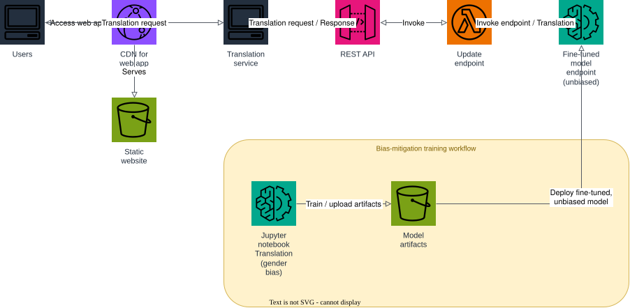

# AWS Project: Bias Mitigation in Translation

This architecture uses generative AI to deliver gender-bias-mitigated machine translation, pairing a live Translation service with an offline training workflow that continuously fine-tunes and redeploys a less-biased model.

1. users access the Translation service web app through a CDN for the web app (CloudFront), which serves the static website (S3);
2. users send a translation request to the Translation service web app, which calls the REST API (API Gateway);
3. the REST API invokes the `update-endpoint` Lambda, which invokes the fine-tuned model endpoint (unbiased) to run the translation, and the response flows back through the chain to the user;
4. separately, a Jupyter notebook trains and evaluates an LLM for gender-bias mitigation in translation: it loads a translation dataset, computes a gender-bias metric, fine-tunes a debiasing glossary, and uploads the resulting model artifacts to the model-artifacts S3 bucket;
5. the fine-tuned, unbiased model artifact is deployed to the fine-tuned model endpoint used by the live service, so subsequent translation requests benefit from the bias mitigation.

## Prerequisites

- Docker
- Terraform 1.5+
- AWS CLI

## Start Floci

```bash
docker compose up -d
```

## Apply Terraform

```bash
terraform init
terraform apply
```

Applying:

- creates the `static-website` S3 bucket and the `model-artifacts` S3 bucket;
- deploys the `model-endpoint` Lambda, which simulates a SageMaker-style
  `invoke_endpoint` call to the fine-tuned, gender-debiased translation
  model (loading the debiasing glossary artifact from `model-artifacts`);
- deploys the `update-endpoint` Lambda, which the REST API (API Gateway)
  invokes and which in turn invokes the `model-endpoint` Lambda to run the
  translation;
- creates the `translation` REST API with a `POST /translate` method proxied
  to the `update-endpoint` Lambda;
- renders [web/index.html.tftpl](web/index.html.tftpl) with the REST API's
  invoke URL and uploads it to the `static-website` bucket, served through
  CloudFront.

## Architecture



The diagram source is a real, editable [draw.io](https://www.drawio.com/) file at [docs/architecture.drawio](docs/architecture.drawio), generated programmatically with the [drawpyo](https://github.com/MerrimanInd/drawpyo) Python library. Open the `.drawio` file directly on GitHub or with the draw.io desktop app / [app.diagrams.net](https://app.diagrams.net/) to edit it.

To regenerate the diagram (`.drawio` source + the `.svg`/`.png` embedded above) after changing the architecture:

```bash
python3 -m venv .diagram-venv
.diagram-venv/bin/pip install drawpyo
.diagram-venv/bin/python scripts/generate_diagram.py

# rasterize the .drawio file to svg/png (used by the README) via headless draw.io
docker run --rm -v "$PWD/docs":/data -w /data rlespinasse/drawio-export -f svg -o . --output-mode relative --remove-page-suffix .
docker run --rm -v "$PWD/docs":/data -w /data rlespinasse/drawio-export -f png -o . --output-mode relative --remove-page-suffix -t .
```

## Request a translation

```bash
API_URL=$(terraform output -raw translation_api_endpoint)

curl -s -X POST "$API_URL" \
  -H "Content-Type: application/json" \
  -d '{"text": "The chairman said he would review it.", "source_lang": "en", "target_lang": "es"}' | jq
```

## Train and deploy the gender-debiasing model

Run the training notebook ([notebooks/train_debias_translation.ipynb](notebooks/train_debias_translation.ipynb)) with the Floci stack running to fine-tune the translation LLM, evaluate its gender-bias score, and upload the resulting artifact to the `model-artifacts` bucket — which the `model-endpoint` Lambda picks up on its next invocation:

```bash
jupyter notebook notebooks/train_debias_translation.ipynb
```

Or inspect the deployed artifact directly:

```bash
BUCKET=$(terraform output -raw model_artifacts_bucket)

aws --endpoint-url http://localhost:4566 s3 cp \
  "s3://$BUCKET/fine-tuned-translation-model/debias_glossary.json" -
```

## Open the web app

```bash
open "https://$(terraform output -raw cloudfront_domain_name)"
```

If you want to follow the execution, watch the Floci container logs:

```bash
docker compose logs -f floci
```

## Clean up

```bash
terraform destroy
docker compose down
```
